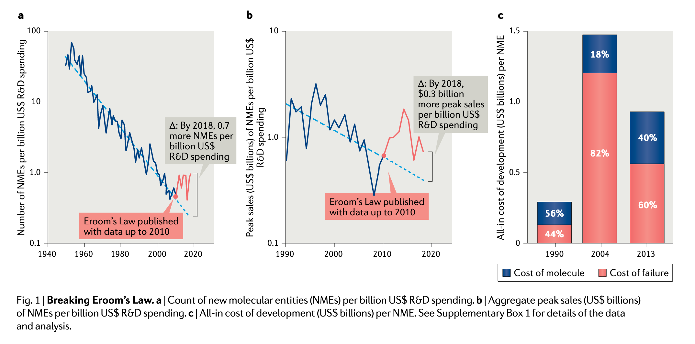

# Why Invest in Biotech?

Biotechnology is fun because of how miserably f~cking hard it is to do on *any* scale without taking into account the *extra* research required not to f~cking kill someone[^rip_patients], or unwittingly give them cancer[@hacein-bey-abina_insertional_2008].

The risk is astronomical, *and* the resulting therapeutics and drugs are designed to treat humanity's most horrifying disorders (like spinal muscular dystrophy in children[@noauthor_zolgensma_nodate]), and so companies are rewarded with such magnanimous amounts of wealth over such a time-span that investors buy promising clinical-stage companies, 4 years pre-product sales for cool billions[@noauthor_lilly_nodate].

"*Interesting, but this problem, seems neither novel, nor difficult to hedge-against per-se*", you reply: "*In so far that a selection of the industry's reward exceeds the industry's average risk, one can theoretically craft a profitable diversification strategy.*"

See, and that's where we start to get a whiff of something contradictory happening: the financial risk/reward ratio is so volatile that, yes, diversification is akin to suggesting someone brush their teeth; *but* if we measure the returns of several diversified biotech ETFs created by financially sophisticated organizations[@noauthor_gnom_nodate] [@noauthor_ishares_nodate] [@noauthor_xbi_nodate], it's about as enticing as gum disease.

What gives?

#| label: fig-biotech-vs-bm
#| fig-cap: "Comparing Biotech ETFs to the S&P 500 Trust (SPY) over the last *five* years, growth has been flat relative to the SPY. It's unclear whether this dynamic will change given R&D advances.[^rd_bites_back]"

import polars as pl
import pandas as pd
import altair as alt

def read_stock(source: str, ticker: str) -> pl.DataFrame:
    return pl.read_csv(source=source, separator="\t").with_columns(Ticker=pl.lit(ticker))

ibb = read_stock("data/ibb_price.tsv", "IBB")
spy = read_stock("data/spy_price.tsv", "SPY")
gnom = read_stock("data/gnom_price.tsv", "GNOM")
xbi = read_stock("data/xbi_price.tsv", "XBI")

phist = ibb.vstack(gnom).vstack(spy).vstack(xbi).rename({"Adj Close ": "Adj_Close"})

chart = alt.Chart(phist.to_pandas()).mark_line().encode(
      x=alt.X('Date:T', title='Date')
    , y=alt.Y('Adj_Close:Q', title='Adjusted Close Price ($USD)' 
    , axis=alt.Axis(format='$,r'))
    , color=alt.Color('Ticker:N', title='Ticker Symbol')
).properties(
      title='Stock Price Comparison: Biotech vs. The SPY'
    , width=600
    , height=400)

chart

# 

# Exciting Dog-Stocks

Like many other pillars of the US economy, biotechnology *seems* to be another conglomerate of mega-corporations which ran into a series of regulatory, financial, and political head-winds.[^biotech_pressures] 

Even if an investor wanted exposure to the industry via ETFs (for example, BlackRock's iShares IBB Biotechnology ETF[@noauthor_ishares_nodate]), the performance has been so... exceptional that the benchmark listed on the [Fact Sheet](https://www.ishares.com/us/literature/fact-sheet/ibb-ishares-biotechnology-etf-fund-fact-sheet-en-us.pdf) is not a market index like the S&P, NASDAQ, or Dow Jones; rather, they use an *industry* index: the [NYSE Biotechnology Index](https://www.nyse.com/publicdocs/data/NYSE_Biotechnology_Index_Methodology.pdf). 

## Benchmarking Biotech ETFs

# What Even Qualifies as "Biotech"?

It's important to first define a "biotech" company versus a pharmaceutical. 

To start with a few important misalignments: 

- Biotech is *not* the same thing as pharma.[^biotech_aint_pharma]

- An IPO is *not* a cost-effective way of increasing shareholder value for many biotech companies.[^biotech_ipos_aint_important]

- Yes, drugs still can and do fail at stage-X clinical trials.[^clinical_trials_risk]

- Just because your drug failed trials doesn't mean it can't be used for something else.[^repurposement]

- Just because your failed drug can be used for something else doesn't mean it'll be worth much when you sell it.

[^biotech_pressures]: It seems profit-pressure is significant and mounting: that the CMS drug-price negotiations[@noauthor_medicare_nodate] survived the transition between administrations shows its bipartisan political value[@muoio_trumps_2025], and large pharmaceutical companies will conceivably need to increase spending[@dunleavy_jj_2025] as the Trump administration pulls NIH funding for drug discovery research[@stein_nih_2025].

[^biotech_aint_pharma]: --TODO #3

[^biotech_ipos_aint_important]: --TODO #4

[^clinical_trials_risk]: --TODO #5

[^repurposement]: --TODO #6

[^biotech_will_survive]: What we now call "biotech" has existed for centuries, withstood skepticism and setbacks throughout, and has, was, and will always be a source of enduring value. Just not always in ways which align with investor expectations. 

[^rd_bites_back]: Biotech is curious for a variety of reasons, but some trivia is that there's an inverse (haha) prediction to [Moore's Law](https://en.wikipedia.org/wiki/Moore%27s_law) specific to biotechnology called "[Eroom's Law](https://en.wikipedia.org/wiki/Eroom%27s_law)" which observes that "...the number of new US Food and Drug Administration (FDA)-approved drugs per billion US dollars of R&D spending in the drug industry has halved approximately every 9 years since 1950, in inflation-adjusted terms."[@scannell_diagnosing_2012] 

    However, since that paper was written in 2012, it's unclear whether we're experiencing a turn-around: the first author of the original paper assisted a follow-up paper in 2020 titled "Breaking Eroom's Law"[@ringel_breaking_2020], describing how advances in bioinformatics, lab instrumentation, and financial engineering *appear* to have broken the statistical prophecy.

    {#fig-breaking_erooms_law}

[^rip_patients]: I'm alluding to the death of Jesse Gelsinger in 1999, a 17 year-old who'd flown to the University of Pennsylvania to take part in an experimental gene-therapy using Adeno-Virus (AV) as the cloning vector[@rinde_death_2019]. 

    While James Wilson[@noauthor_james_nodate] *did* forge consent, withhold information about the riskiness of the therapy, and have a conflict of interest in the study, his team did further research into how and why the disaster occurred: 

    > He and his team concluded that the teenager had probably experienced a rare phenomenon called *antibody-dependent enhancement*. Jesse had been previously exposed to the adenovirus that was used in the trial, they surmised, ***which created antibodies that supercharged the subsequent reinfection rather than fighting it.***[@rinde_death_2019]

    Because of that post-mortem research, despite the national outcry and the resulting political backlash on gene-therapy research via human stem-cells[@noauthor_president_2006], researchers were able to continue work for years to craft increasingly safe and reliable cloning vectors like adeno-associated virus (AAV), and lentivirus.[@bulcha_viral_2021] 
    
    Ultimately, even with all the incredible research put forward over decades, people still die[@gibney_teens_2025]- and unfortunately, they're the same highly-at-risk, vulnerable populations who's suffering moves the public's willingness to accept the risk in the first place (like children with spinal muscular dystrophy[@noauthor_zolgensma_nodate]) who pass away[@carstens_two_2022]. 